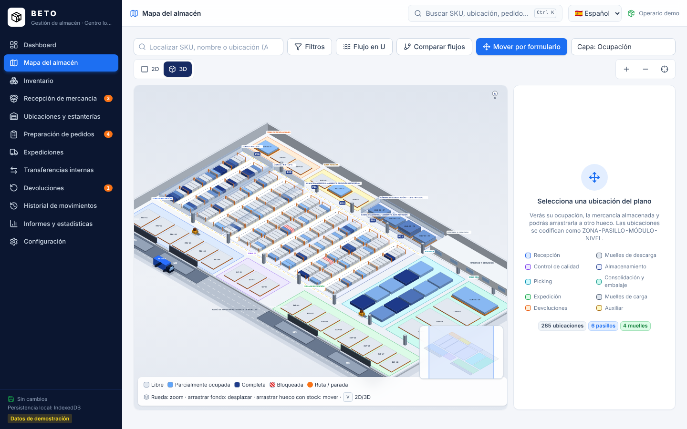

# BETO — Sistema de gestión de almacén (BETO S.L.)

Aplicación web profesional e interactiva para gestionar un almacén moderno, inspirada en la guía
*Anatomía y operativa del almacén moderno*: flujo en U, zonificación, pasillos rectos de sentido
único, codificación en peine y las cinco funciones (recepción, almacenamiento, conservación,
expedición/picking y control de existencias) más la gestión de retornos.

Catálogo de demostración de **BETO S.L.**: quesos, salmón, piñas y recipientes de plástico, cada familia
con condiciones de conservación propias (temperatura, forma y tamaño) que el sistema valida al ubicar.

La aplicación se presenta con la marca **BETO**. Interfaz en **español por defecto**, con cambio a **中文** e **inglés** desde la cabecera o Configuración.



## Ejecutar

```bash
cd warehouse-pro
npm install
npm run dev        # http://localhost:5173
```

Otros comandos:

```bash
npm run build      # typecheck + build de producción en dist/
npm run preview    # sirve dist/ en http://localhost:4173
npm test           # pruebas unitarias de dominio y persistencia (Vitest)
node scripts/e2e.mjs   # pruebas de navegador (requiere `npm run preview` en marcha y Chromium)
```

Requisitos: Node 20+ y un navegador moderno con IndexedDB.

## Dependencias

| Paquete | Uso |
| --- | --- |
| react 19, react-dom | Interfaz |
| typescript 5 | Tipado estricto |
| vite 7, @vitejs/plugin-react | Empaquetado y servidor de desarrollo |
| tailwindcss 4, @tailwindcss/vite | Estilos (tema propio: azul marino, azul eléctrico, verde, naranja, amarillo, rojo) |
| zustand 5 | Estado de la aplicación y despachador de operaciones |
| idb 8 | Persistencia en IndexedDB |
| recharts 3 | Gráficos del dashboard e informes |
| lucide-react | Iconos |
| vitest, fake-indexeddb | Pruebas automatizadas |
| playwright-core (dev) | Pruebas de navegador y renderizado del logotipo |

El plano interactivo es una implementación propia en **SVG** (sin biblioteca de mapas ni de drag and drop).

## Estructura de archivos

```
warehouse-pro/
├── index.html, vite.config.ts, vitest.config.ts, tsconfig*.json
├── public/
│   ├── logo.svg, logo.png          # logotipo (caja con flecha) en negro sin fondo
│   └── img/*.svg                   # ilustraciones de las 4 familias de producto
├── scripts/
│   ├── e2e.mjs                     # pruebas end-to-end con Chromium
│   └── svg2png.mjs                 # rasterizado del logotipo
├── docs/capturas/                  # capturas de pantalla de la aplicación
└── src/
    ├── domain/                     # CAPA DE DOMINIO (pura, sin React)
    │   ├── types.ts                # entidades: Product, Zone, Location, StockEntry, Order, Receipt, Shipment, Transfer, Return, Movement
    │   ├── layout.ts               # plano: zonas, 6 pasillos, muelles, codificación ZONA-PASILLO-MÓDULO-NIVEL, rutas
    │   ├── operations.ts           # reglas de negocio y operaciones atómicas (recepción, picking, expedición, transferencias, devoluciones…)
    │   ├── queries.ts              # consultas: disponible, reservado, ocupación, alertas, integridad
    │   ├── seed.ts                 # datos de demostración de BETO S.L.
    │   ├── operations.test.ts      # pruebas de los escenarios obligatorios
    │   └── errors.ts, ids.ts
    ├── data/
    │   ├── repository.ts           # interfaz WarehouseRepository + IndexedDB / localStorage / memoria
    │   └── repository.test.ts
    ├── store/useWarehouse.ts       # estado global, dispatch atómico, guardado automático, notificaciones
    ├── lib/                        # i18n (es/zh/en), router hash, formato, CSV, analítica, sugerencia de ubicaciones, etiquetas
    ├── components/                 # kit UI (botones, tablas, modales, toasts…), Shell con barra lateral, búsqueda global
    └── features/                   # pantallas: Dashboard, map/ (plano), Inventory, Receipts, Locations, Orders, Shipments, Transfers, Returns, History, Reports, Settings
```

## Arquitectura

- **Dominio puro e inmutable**: cada operación recibe el estado, trabaja sobre una copia y devuelve el nuevo
  estado o lanza `DomainError`. Si falla, el estado original no se toca (atomicidad). Las validaciones viven
  aquí y la interfaz las reutiliza (p. ej. `checkCanReceive` para resaltar destinos válidos al arrastrar).
- **Capa de datos separada**: `WarehouseRepository` guarda el snapshot completo en IndexedDB en una
  transacción. Sustituir esta clase por un cliente HTTP permite incorporar una API y PostgreSQL sin tocar
  dominio ni interfaz. No se simula ningún servidor remoto.
- **Interfaz**: React + Tailwind. El store despacha operaciones, persiste con un pequeño debounce y
  muestra notificaciones de éxito/error. Todas las pantallas leen el mismo estado, por lo que cualquier
  operación se refleja de inmediato en dashboard, mapa, inventario e informes.

### Modelo de ubicaciones

Código `ZONA-PASILLO-MÓDULO-NIVEL` (p. ej. `A-01-03-02`). Codificación en peine: módulos impares a la
izquierda del pasillo y pares a la derecha; niveles numerados desde el suelo. Zonas de almacenamiento:

| Zona | Pasillos | Condición | Mercancía |
| --- | --- | --- | --- |
| A | 01–02 | Ambiente, alta rotación (junto a picking) | recipientes de alta rotación |
| B | 03–04 | Ambiente, rotación media/baja | recipientes voluminosos, reserva |
| C | 05 | Cámara fresca 8–13 °C | piñas |
| D | 06 | Cámara refrigerada 0–4 °C | quesos, salmón fresco |
| CNG | suelo | Cámara de congelación −18 °C | salmón congelado |

Más zonas operativas: recepción (REC), control de calidad (QC), picking (PCK), consolidación (CON),
expedición (EXP), devoluciones (DEV), auxiliar (AUX) y 4 muelles: 2 de descarga (M1-M2) y 2 de carga (M3-M4).
Cada ubicación tiene capacidad, peso máximo, tamaño admitido (L en nivel 1 y suelo, M en niveles 2–3, S en nivel 4),
estado (libre / parcial / completa / bloqueada) y mercancía por SKU y estado físico
(disponible, cuarentena, dañado, obsoleto, devolución a proveedor).

## Puestos de trabajo

Selector de puesto en la cabecera (y en Configuración). Cada puesto ve solo sus secciones, tiene su propia
pantalla de inicio y una lista de «Mis tareas» en el dashboard; las acciones ajenas al puesto se ocultan o deshabilitan.

| Puesto | Secciones | Puede |
| --- | --- | --- |
| Jefe de almacén | Todas | Todo: configuración, informes, bloqueos, ajustes, altas de productos y ubicaciones |
| Operario de recepción | Dashboard, mapa, recepción, inventario, ubicaciones, transferencias, devoluciones, historial | Recepciones, calidad, transferencias, registrar e inspeccionar devoluciones |
| Preparador de pedidos | Dashboard, mapa, pedidos, inventario, transferencias, historial | Picking, rutas, transferencias |
| Responsable de expedición | Dashboard, mapa, expediciones, pedidos, devoluciones, inventario, historial | Crear y confirmar expediciones, crear pedidos, registrar retornos |

## Funciones implementadas

- **Dashboard**: KPIs calculados del estado real, gráfico de entradas/salidas, alertas, últimos movimientos,
  accesos rápidos y tarjetas de los módulos prioritarios (Expediciones, Organización, Preparación, Retornos).
- **Mapa del almacén (SVG)**: zoom con rueda/pinza y botones, desplazamiento, selección de cualquier hueco,
  panel lateral con detalle, indicadores de ocupación, búsqueda de SKU con resaltado, filtros por zona/estado/
  temperatura/tipo de mercancía, leyenda, recentrado, ruta de picking de un pedido y ruta entre dos
  ubicaciones (con distancia estimada), capa animada de flujo en U, comparación U vs línea recta,
  camiones animados en los muelles según recepciones/expediciones pendientes.
- **Drag and drop real**: arrastrar un hueco con stock (o la mercancía desde el panel) a otro hueco;
  el destino se resalta en verde si es válido o en rojo con el motivo (bloqueado, capacidad, peso,
  temperatura, tamaño); confirmación con cantidad parcial; actualiza inventario y registra la transferencia.
  Alternativa por formulario para dispositivos táctiles.
- **Inventario**: tabla con búsqueda, filtros, ordenación, paginación, ficha completa con historial,
  alta/edición con validaciones (SKU único, sin negativos), archivado, exportación e importación CSV validada.
- **Recepción**: crear → iniciar → registrar recibido/dañado → control de calidad (cuarentena física en QC)
  → aprobar/rechazar → asignar destino (sugerencia automática) → confirmar (idempotente por línea).
  Estados: borrador, pendiente, en recepción, en control de calidad, parcial, completada, incidencia.
- **Ubicaciones**: crear, editar capacidad/peso/tamaño, bloquear/desbloquear, eliminar si está vacía.
- **Preparación de pedidos**: reserva por ubicación sin solapamientos entre pedidos, faltantes señalados,
  lista de picking en orden serpenteante por pasillos, confirmación parcial por línea y ubicación,
  "recoger todo", cancelación con liberación de reservas y retorno de lo recogido.
- **Expediciones**: selección de pedidos preparados, traslado a zona de expedición, transportista,
  referencia, fecha, observaciones, confirmación final idempotente (botón de prueba incluido), cancelación.
- **Transferencias internas**: formulario con disponible/capacidad, historial, motivo, usuario, errores registrados.
- **Devoluciones**: registro (opcionalmente contra pedido enviado, con límite de cantidad), entrada en
  cuarentena, inspección con clasificación (apta → vuelve al stock en ubicación compatible; dañada/obsoleta →
  zona auxiliar no disponible; devolución a proveedor → salida documentada), retirada de mercancía no disponible.
- **Historial**: registro inmutable con ID, fecha/hora, tipo, SKU, cantidad, origen, destino, referencia,
  usuario, resultado y observaciones; filtros y exportación CSV. Las correcciones son ajustes documentados.
- **Informes**: evolución del stock, entradas/salidas por día, movimientos por periodo, ocupación por zona,
  rotación, sin movimiento, stock mínimo, productividad de picking, pedidos pendientes, incidencias de
  recepción; filtro por periodo y exportación CSV.
- **Configuración**: nombre, usuario, calidad por defecto, idioma, comprobación de integridad,
  exportar/importar copia JSON, restaurar demo (con confirmación) y vaciar almacén.
- Usabilidad: validaciones, confirmaciones, toasts, estados de carga y vacíos, tooltips, búsqueda global
  (Ctrl+K o `/`), atajos Alt+1…0, Esc, accesibilidad por teclado, diseño responsive.

## Pruebas realizadas

`npm test` → 15 pruebas, todas correctas (`src/domain/operations.test.ts`, `src/data/repository.test.ts`):

1. Crear producto y encontrarlo en inventario ✔
2. Asignar producto a ubicación ✔
3. Mover 30 de 100 unidades ✔ 4. Origen 70 / destino +30 ✔
5. Mover más de lo disponible → rechazado ✔
6. Superar capacidad → rechazado ✔
7. Ubicación bloqueada → rechazada ✔ (y temperatura/tamaño incompatibles)
8. Recepción con calidad: cuarentena, sin stock disponible hasta confirmar, dañados a zona auxiliar ✔
9. Dos pedidos no reservan las mismas unidades ✔
10. Preparar y expedir sin descontar dos veces; expedición idempotente ✔
11. Cancelar pedido libera reservas y devuelve lo recogido ✔
12. Devolución dañada no aumenta el disponible; apta sí tras inspección ✔
13. Persistencia en IndexedDB (fake-indexeddb) ✔
14. Datos de demostración coherentes (integridad) ✔ 15. Cada operación aparece en el historial ✔

`node scripts/e2e.mjs` (Chromium real) → 12/12: carga del dashboard, selección en el plano, arrastrar y
soltar con confirmación, cantidades de origen/destino, persistencia tras recargar la página, historial,
ruta de picking dibujada, capturas de todas las pantallas (ver `docs/capturas/`), sin errores de consola.

## Limitaciones reales

- **Versión local monousuario**: los datos viven en IndexedDB del navegador del equipo. Para varios
  trabajadores compartiendo el inventario hace falta un backend con base de datos (PostgreSQL), autenticación
  y sincronización; la capa `WarehouseRepository` está preparada para ello pero no existe todavía.
- No hay usuarios ni permisos: el "usuario responsable" es un texto configurable.
- Las rutas de picking usan un recorrido serpenteante por pasillos y corredores; no es un optimizador exacto.
- La capacidad se mide en unidades por hueco (más el peso máximo); no hay cálculo volumétrico por posición.
- Las imágenes de producto son ilustraciones vectoriales por familia; se puede indicar una URL por producto.
- El diccionario chino/inglés cubre toda la interfaz; los nombres de productos y clientes de la demo se
  mantienen en su idioma original.
